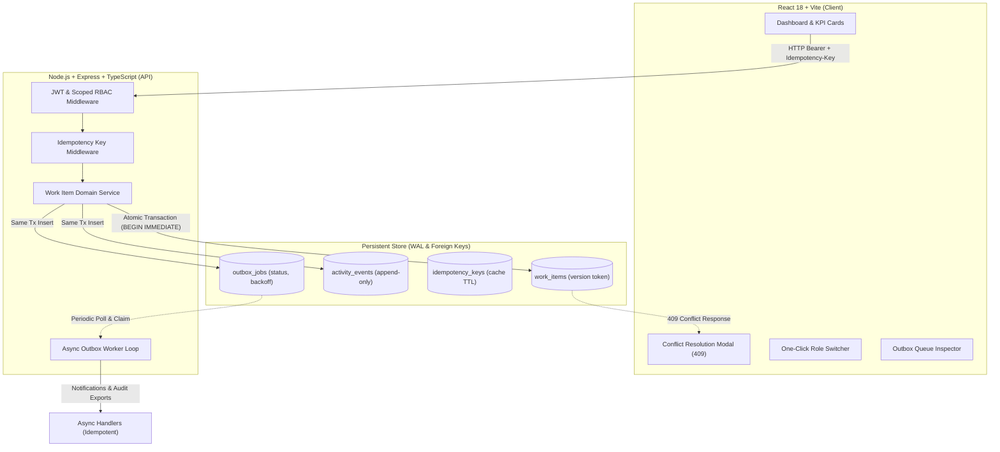

# Newtonite — Operations Under Pressure
### High-Reliability Operational Work Item Coordination Platform

> Built for the Newtonite Full-Stack Software Engineering Challenge.  
> An internal system that enables cross-functional engineering, operations, payments, compliance, and customer support teams to manage and resolve high-stakes operational work items reliably under concurrency, pressure, and scale.

**🌐 Live Production Deployment:** [https://newtonite-lemon.vercel.app](https://newtonite-lemon.vercel.app)  
**📦 GitHub Repository:** [https://github.com/Navyansh999/dashboard-](https://github.com/Navyansh999/dashboard-)

---

## ⚡ What the System Does
- **Coordinates Operational Work:** Tracks incidents, customer escalations, payment discrepancies, and compliance audits with clarity on why each item exists, its urgency, its current owner, and what actions must occur next.
- **Guarantees Correctness Beyond CRUD:** Enforces atomic claims to prevent duplicate worker collision, optimistic concurrency locking (`v1, v2...`) to eliminate stale overwrites, `Idempotency-Key` headers for safe retries, and strict server-enforced workflow state machines with Lead approval gates.
- **Auditable & Resilient:** Maintains an append-only audit trail written within the exact same database transaction as work item mutations, coupled with a Transactional Outbox pattern that guarantees at-least-once async notifications with exponential backoff.

---

## 🏛️ System Architecture



---

## 🚀 Quickstart & Setup Instructions

### Prerequisites
- **Node.js** >= v20 (Developed and verified on Node.js v24.19.0)
- **npm** >= v10
- *(Optional)* **Docker & Docker Compose**

### Option A: Local Run (Zero External Dependencies)
Newtonite is built to run immediately out-of-the-box on any fresh machine using Node's built-in high-performance storage engine (WAL mode with transactions):

```bash
# 1. Clone repository and navigate to folder
cd newtonite

# 2. Install all dependencies across workspaces
npm install

# 3. Seed database with teams, users, and realistic items
npm run seed

# 4. Start backend (port 5000) and frontend (port 3000) simultaneously
npm run dev
```

Open your browser at **http://localhost:3000**. The server runs on **http://localhost:5000**.

---

### Option B: Docker Compose
```bash
docker compose up --build
```
This launches the containerized service with persisted database volumes.

---

## 🧪 Automated Testing

All critical behaviors beyond simple CRUD are covered with automated integration tests:

```bash
# Run all automated tests with a single command
npm test
```

### Critical Behaviours Tested (12/12 Passing):
1. **Concurrent Claim Race Condition (`tests/concurrency.test.ts`):**  
   Fires two claims simultaneously in parallel. Exactly one succeeds with HTTP 200, the second receives HTTP 409 Conflict with the winner's identity.
2. **Optimistic Concurrency Control (`tests/optimistic-locking.test.ts`):**  
   User A advances an item from `v2` to `v3`. User B submits an edit with stale version `v2`. Rejected with HTTP 409 Conflict, returning latest server state.
3. **Idempotent Mutations (`tests/idempotency.test.ts`):**  
   Replaying identical requests with the same `Idempotency-Key` header returns identical cached HTTP 201 response without duplicating database records.
4. **Workflow State Machine & Lead Approval Gate (`tests/workflow-rules.test.ts`):**  
   Illegal status transitions (e.g. `OPEN -> CLOSED`) are rejected with HTTP 400. Approving items from `AWAITING_APPROVAL -> RESOLVED` by non-Leads is rejected with HTTP 403 Forbidden; Leads succeed.
5. **Resource-Level Authorization (`tests/authorization.test.ts`):**  
   Users cannot read or mutate work items belonging to unauthorized teams (HTTP 403 Forbidden). Company Admins retain cross-team visibility.
6. **Transactional Outbox Worker (`tests/outbox-worker.test.ts`):**  
   Outbox rows are created in the same database transaction as the entity change. Worker processes jobs with retry backoff and caps failures at max retries.

---

## 👥 Seed Demo Personas (Instant Switcher)

Use the persona dropdown in the top navbar to switch users in 1 click and experience the role-based authorization model:

| User Name | Role & Team Assignment | Capabilities / Intended Test Flow |
|---|---|---|
| **Sarah Chen** | `LEAD` (Platform Core), `MEMBER` (Payments) | Can claim Core items, edit, and approve items to `RESOLVED` in Platform Core. |
| **Elena Rostova** | `LEAD` (Payments & Settlement) | Can approve wire transfer discrepancies and manage Payments workflow. |
| **Priya Patel** | `ADMIN` (Compliance & Company-wide) | Has company-wide administrative privileges across all teams and audit exports. |
| **David Kim** | `MEMBER` (Platform Core) | Can claim and update items in Core; blocked from approving without Lead role. |
| **Alex Rivera** | `MEMBER` (Customer Operations) | Scoped to Customer Ops. Blocked from viewing or claiming Platform Core items (HTTP 403). |
| **Marcus Brody** | `VIEWER` (Compliance, Customer Ops) | Read-only auditor. Blocked from claiming or mutating items. |

---

## 🛠️ Tech Stack & Key Choices

- **Backend:** Node.js, Express, TypeScript, Zod, JWT, built-in high performance transactional database with WAL mode and `PRAGMA busy_timeout = 5000`.
- **Frontend:** React 18, Vite, TypeScript, Lucide Icons, Vanilla CSS with custom design tokens, dark enterprise glassmorphism, responsive grid layout.
- **Testing:** Vitest, Supertest, sequential test runner.
- **Containerization:** Multi-stage Dockerfile, `docker-compose.yml`.

---

## ⚠️ Known Limitations & Assumptions

1. **In-App Notification Sink:** Outbox background workers process and log notifications reliably with exponential backoff and idempotency; external SMTP/Slack dispatch is stubbed out for local reproducibility.
2. **Eventual Consistency in Outbox Poller:** The background worker polls on a 2-second interval (or manual trigger). For high-scale deployments, a Postgres `LISTEN / NOTIFY` or Kafka queue would provide sub-millisecond push triggers.
3. **Authentication:** Uses seeded demo users with JWT authentication. Production would integrate corporate SAML/OIDC SSO (Okta, Google Workspace).

---

## 🔮 What I Would Build Next With Another Week

1. **WebSocket / SSE Live Delta Streaming:** Push live update toasts when another user claims or modifies an item you are viewing, eliminating conflict surprises before submission.
2. **SLA Breach Predictor Worker:** An outbox-driven cron evaluating response time against contractual thresholds and escalating high-priority work items automatically.
3. **Granular Field-Level Diffing:** Merge non-conflicting concurrent edits (e.g., User A edits description while User B updates due date) using three-way merge semantics.
4. **Saved Views & Custom Query Builder:** Allow team leads to save and share custom multi-filter operational dashboards.
